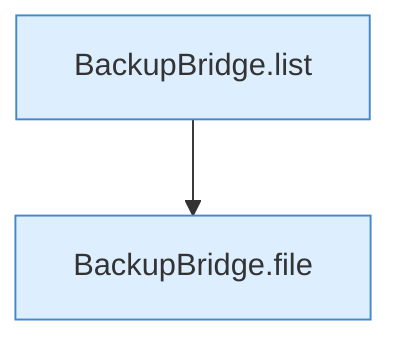

[[00 Start]] › [[Tests]] › [[HosterTest]] › [[HosterTest.Teil3]] › [[HosterTest.backupZipAndExternalJdbc]] › [[HosterTest.backupZipAndExternalJdbc.Teil6]]

# HosterTest.backupZipAndExternalJdbc.Teil6



```knoten
BackupBridge.list
  Die Sicherung auf diesem Rechner zeigt das. Listet `list`. Ruft `directory`, `safeId`, `named`.
BackupBridge.file
  Die Sicherung auf diesem Rechner macht hier einen einzelnen Schritt. Eine Ebene tiefer steht er genauer. Liefert die Datei `file`. Ruft `safeId`, `named`, `directory`.
```

> [!knoten]- Was die Blöcke tun
> - **BackupBridge.list**: Die Sicherung auf diesem Rechner zeigt das. Listet `list`. Ruft `directory`, `safeId`, `named`.
> - **BackupBridge.file**: Die Sicherung auf diesem Rechner macht hier einen einzelnen Schritt. Eine Ebene tiefer steht er genauer. Liefert die Datei `file`. Ruft `safeId`, `named`, `directory`.

- Ein weiterer Abschnitt derselben Übersicht.
- Fortsetzung von `HosterTest.backupZipAndExternalJdbc`.
