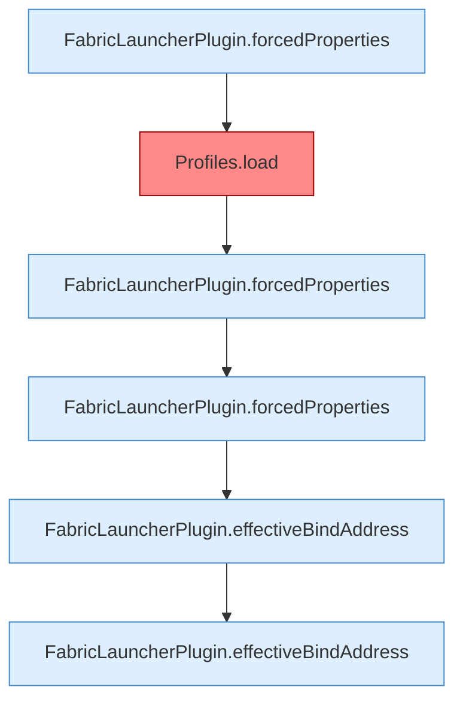

[[00 Start]] › [[Tests]] › [[HosterTest]] › [[HosterTest.Teil1]] › [[HosterTest.bindAddressInheritsHostUnlessExplicitlyOverridden]] › [[HosterTest.bindAddressInheritsHostUnlessExplicitlyOverridden.Teil2]]

# HosterTest.bindAddressInheritsHostUnlessExplicitlyOverridden.Teil2



```knoten
FabricLauncherPlugin.forcedProperties
  Erzwingt `forcedProperties`. Ruft `effectiveBindAddress`.
Profiles.load
  Lädt `load`. Ruft `one`, `str`, `copyId`. Befund: angemeldet aber nicht umgesetzt (sicher).
FabricLauncherPlugin.effectiveBindAddress
  Liefert den wirksamen Wert `effectiveBindAddress`.
```

- Fortsetzung von `HosterTest.bindAddressInheritsHostUnlessExplicitlyOverridden`, Quellreihenfolge.
