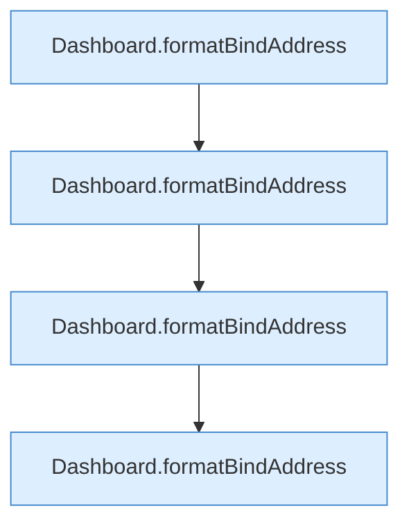

[[00 Start]] › [[Tests]] › [[HosterTest]] › [[HosterTest.Teil1]] › [[HosterTest.bindAddressInheritsHostUnlessExplicitlyOverridden]] › [[HosterTest.bindAddressInheritsHostUnlessExplicitlyOverridden.Teil3]]

# HosterTest.bindAddressInheritsHostUnlessExplicitlyOverridden.Teil3

- Fortsetzung von `HosterTest.bindAddressInheritsHostUnlessExplicitlyOverridden`, Quellreihenfolge.
