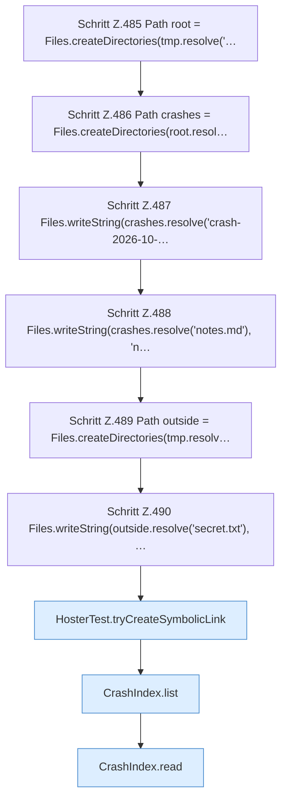

[[00 Start]] › [[Tests]] › [[HosterTest]] › [[HosterTest.Teil4]] › [[HosterTest.crashIndexReadsAndRejectsEscape]] › [[HosterTest.crashIndexReadsAndRejectsEscape.Teil1]]

# HosterTest.crashIndexReadsAndRejectsEscape.Teil1



```knoten
Schritt Z.485 Path root = Files.createDirectories(tmp.resolve('…
  Zeile 485: Dateioperation. `Path root = Files.createDirectories(tmp.resolve('…`
Schritt Z.486 Path crashes = Files.createDirectories(root.resol…
  Zeile 486: Dateioperation. `Path crashes = Files.createDirectories(root.resol…`
Schritt Z.487 Files.writeString(crashes.resolve('crash-2026-10-…
  Zeile 487: schreibt Text in eine Datei. `Files.writeString(crashes.resolve('crash-2026-10-…`
Schritt Z.488 Files.writeString(crashes.resolve('notes.md'), 'n…
  Zeile 488: schreibt Text in eine Datei. `Files.writeString(crashes.resolve('notes.md'), 'n…`
Schritt Z.489 Path outside = Files.createDirectories(tmp.resolv…
  Zeile 489: Dateioperation. `Path outside = Files.createDirectories(tmp.resolv…`
Schritt Z.490 Files.writeString(outside.resolve('secret.txt'), …
  Zeile 490: schreibt Text in eine Datei. `Files.writeString(outside.resolve('secret.txt'), …`
HosterTest.tryCreateSymbolicLink
  Ein Schritt in einem [[Glossar#Probelauf|Probelauf]]. Er gehört nicht zum laufenden Server. `tryCreateSymbolicLink` in `HosterTest.java`. Nur Test.
CrashIndex.list
  Dieser Teil zeigt das. Listet `list`. Ruft `open`, `resolve`.
CrashIndex.read
  Dieser Teil liest das. Liest `read`. Ruft `open`, `resolve`, `query`.
```

> [!knoten]- Was die Blöcke tun
> - **Schritt Z.485 Path root = Files.createDirectories(tmp.resolve('…**: Zeile 485: Dateioperation. `Path root = Files.createDirectories(tmp.resolve('…`
> - **Schritt Z.486 Path crashes = Files.createDirectories(root.resol…**: Zeile 486: Dateioperation. `Path crashes = Files.createDirectories(root.resol…`
> - **Schritt Z.487 Files.writeString(crashes.resolve('crash-2026-10-…**: Zeile 487: schreibt Text in eine Datei. `Files.writeString(crashes.resolve('crash-2026-10-…`
> - **Schritt Z.488 Files.writeString(crashes.resolve('notes.md'), 'n…**: Zeile 488: schreibt Text in eine Datei. `Files.writeString(crashes.resolve('notes.md'), 'n…`
> - **Schritt Z.489 Path outside = Files.createDirectories(tmp.resolv…**: Zeile 489: Dateioperation. `Path outside = Files.createDirectories(tmp.resolv…`
> - **Schritt Z.490 Files.writeString(outside.resolve('secret.txt'), …**: Zeile 490: schreibt Text in eine Datei. `Files.writeString(outside.resolve('secret.txt'), …`
> - **HosterTest.tryCreateSymbolicLink**: Ein Schritt in einem [[Glossar#Probelauf|Probelauf]]. Er gehört nicht zum laufenden Server. `tryCreateSymbolicLink` in `HosterTest.java`. Nur Test.
> - **CrashIndex.list**: Dieser Teil zeigt das. Listet `list`. Ruft `open`, `resolve`.
> - **CrashIndex.read**: Dieser Teil liest das. Liest `read`. Ruft `open`, `resolve`, `query`.

- Ein weiterer Abschnitt derselben Übersicht.
- Fortsetzung von `HosterTest.crashIndexReadsAndRejectsEscape`.
