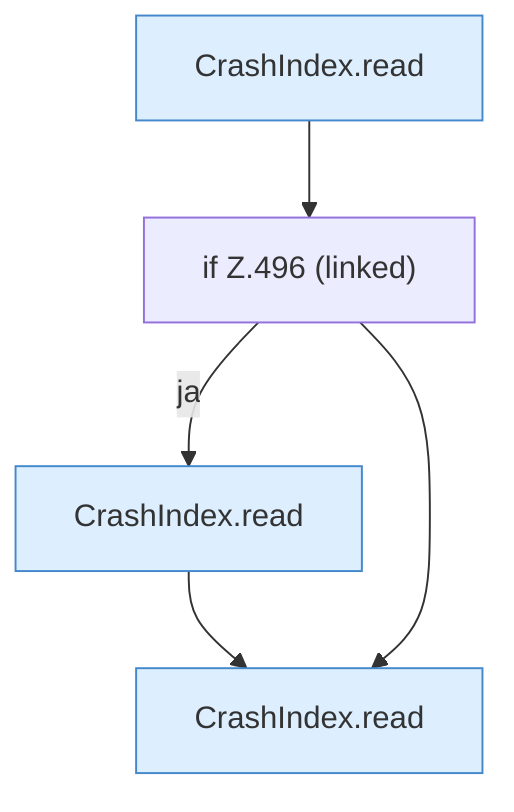

[[00 Start]] › [[Tests]] › [[HosterTest]] › [[HosterTest.Teil4]] › [[HosterTest.crashIndexReadsAndRejectsEscape]] › [[HosterTest.crashIndexReadsAndRejectsEscape.Teil2]]

# HosterTest.crashIndexReadsAndRejectsEscape.Teil2

- Fortsetzung von `HosterTest.crashIndexReadsAndRejectsEscape`, Quellreihenfolge.
