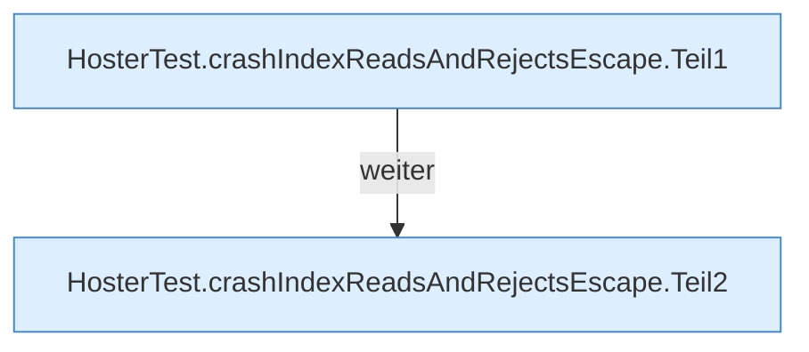

[[00 Start]] › [[Tests]] › [[HosterTest]] › [[HosterTest.Teil4]] › [[HosterTest.crashIndexReadsAndRejectsEscape]]

# HosterTest.crashIndexReadsAndRejectsEscape

`HosterTest.crashIndexReadsAndRejectsEscape()` [src/test/java/de/aichele/childlauncher/HosterTest.java:484–498](https://github.com/Sciddie/minecraft-serverhoster-plugin/blob/95b02b953b0b4c23673e900e021a7c3c844aa37d/src/test/java/de/aichele/childlauncher/HosterTest.java#L484-L498)



```knoten
HosterTest.crashIndexReadsAndRejectsEscape.Teil1
  Abschnitt 1 dieses Ablaufs, in Quellreihenfolge.
HosterTest.crashIndexReadsAndRejectsEscape.Teil2
  Abschnitt 2 dieses Ablaufs, in Quellreihenfolge.
```

- `crashIndexReadsAndRejectsEscape` in `src/test/java/de/aichele/childlauncher/HosterTest.java`
- Auslöser: Test
