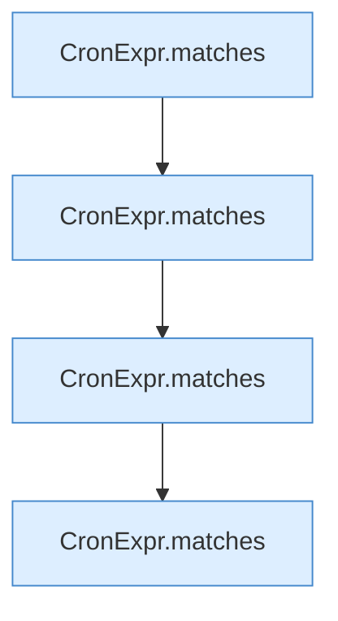

[[00 Start]] › [[Tests]] › [[HosterTest]] › [[HosterTest.Teil2]] › [[HosterTest.cronRespectsZoneAndSunday]] › [[HosterTest.cronRespectsZoneAndSunday.Teil1]]

# HosterTest.cronRespectsZoneAndSunday.Teil1

- Fortsetzung von `HosterTest.cronRespectsZoneAndSunday`, Quellreihenfolge.
