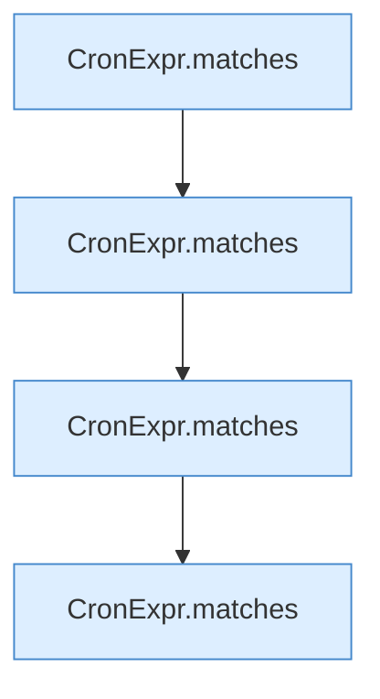

[[00 Start]] › [[Tests]] › [[HosterTest]] › [[HosterTest.Teil2]] › [[HosterTest.cronRespectsZoneAndSunday]] › [[HosterTest.cronRespectsZoneAndSunday.Teil1]]

# HosterTest.cronRespectsZoneAndSunday.Teil1



```knoten
CronExpr.matches
  Dieser Teil macht hier einen einzelnen Schritt. Eine Ebene tiefer steht er genauer. `matches` in `CronExpr.java`. Ruft `field`, `dow`.
```

> [!knoten]- Was die Blöcke tun
> - **CronExpr.matches**: Dieser Teil macht hier einen einzelnen Schritt. Eine Ebene tiefer steht er genauer. `matches` in `CronExpr.java`. Ruft `field`, `dow`.

- Ein weiterer Abschnitt derselben Übersicht.
- Fortsetzung von `HosterTest.cronRespectsZoneAndSunday`.
