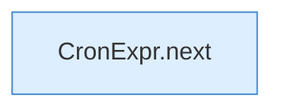

[[00 Start]] › [[Tests]] › [[HosterTest]] › [[HosterTest.Teil2]] › [[HosterTest.cronRespectsZoneAndSunday]] › [[HosterTest.cronRespectsZoneAndSunday.Teil3]]

# HosterTest.cronRespectsZoneAndSunday.Teil3



```knoten
CronExpr.next
  Dieser Teil geht weiter bei das. Geht zum nächsten Schritt `next`. Ruft `matches`, `field`.
```

> [!knoten]- Was die Blöcke tun
> - **CronExpr.next**: Dieser Teil geht weiter bei das. Geht zum nächsten Schritt `next`. Ruft `matches`, `field`.

- Ein weiterer Abschnitt derselben Übersicht.
- Fortsetzung von `HosterTest.cronRespectsZoneAndSunday`.
