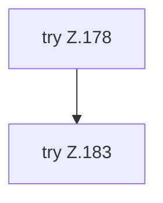

[[00 Start]] › [[Tests]] › [[HosterTest]] › [[HosterTest.Teil2]] › [[HosterTest.dashboardKeepsHosterDataAndBundledVoxelDashAttribution]] › [[HosterTest.dashboardKeepsHosterDataAndBundledVoxelDashAttribution.Teil1]]

# HosterTest.dashboardKeepsHosterDataAndBundledVoxelDashAttribution.Teil1



```knoten
try Z.178
  Zeile 178: Versuch. Der Fehlerpfad geht in catch.
try Z.183
  Zeile 183: Versuch. Der Fehlerpfad geht in catch.
```

> [!knoten]- Was die Blöcke tun
> - **try Z.178**: Zeile 178: Versuch. Der Fehlerpfad geht in catch.
> - **try Z.183**: Zeile 183: Versuch. Der Fehlerpfad geht in catch.

- Ein weiterer Abschnitt derselben Übersicht.
- Fortsetzung von `HosterTest.dashboardKeepsHosterDataAndBundledVoxelDashAttribution`.
