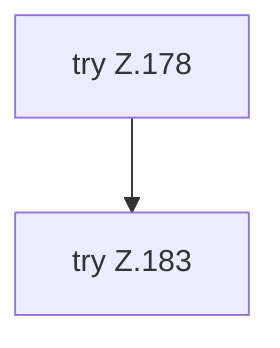

[[00 Start]] › [[Tests]] › [[HosterTest]] › [[HosterTest.Teil2]] › [[HosterTest.dashboardKeepsHosterDataAndBundledVoxelDashAttribution]] › [[HosterTest.dashboardKeepsHosterDataAndBundledVoxelDashAttribution.Teil1]]

# HosterTest.dashboardKeepsHosterDataAndBundledVoxelDashAttribution.Teil1

- Fortsetzung von `HosterTest.dashboardKeepsHosterDataAndBundledVoxelDashAttribution`, Quellreihenfolge.
