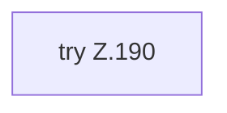

[[00 Start]] › [[Tests]] › [[HosterTest]] › [[HosterTest.Teil2]] › [[HosterTest.dashboardKeepsHosterDataAndBundledVoxelDashAttribution]] › [[HosterTest.dashboardKeepsHosterDataAndBundledVoxelDashAttribution.Teil2]]

# HosterTest.dashboardKeepsHosterDataAndBundledVoxelDashAttribution.Teil2



```knoten
try Z.190
  Zeile 190: Versuch. Der Fehlerpfad geht in catch.
```

- Fortsetzung von `HosterTest.dashboardKeepsHosterDataAndBundledVoxelDashAttribution`, Quellreihenfolge.
