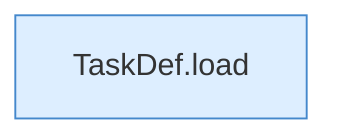

[[00 Start]] › [[Tests]] › [[HosterTest]] › [[HosterTest.Teil1]] › [[HosterTest.defaultDailyBackupUsesServerLocalTime]]

# HosterTest.defaultDailyBackupUsesServerLocalTime

`HosterTest.defaultDailyBackupUsesServerLocalTime()` [src/test/java/de/aichele/childlauncher/HosterTest.java:55–62](https://github.com/Sciddie/minecraft-serverhoster-plugin/blob/95b02b953b0b4c23673e900e021a7c3c844aa37d/src/test/java/de/aichele/childlauncher/HosterTest.java#L55-L62)



```knoten
TaskDef.load
  Lädt `load`. Ruft `str`, `TaskDef`.
```

- `defaultDailyBackupUsesServerLocalTime` in `src/test/java/de/aichele/childlauncher/HosterTest.java`
- Auslöser: Test
