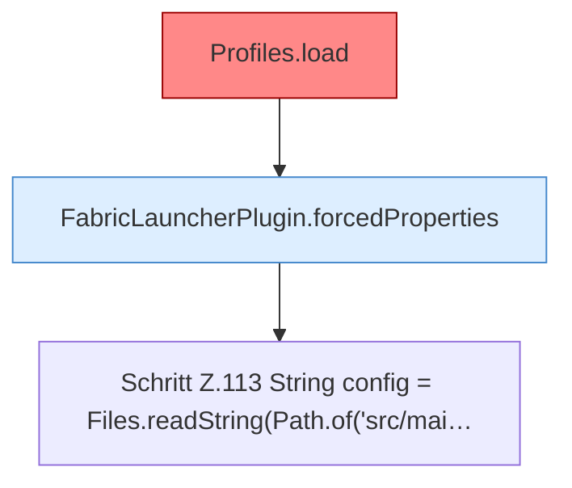

[[00 Start]] › [[Tests]] › [[HosterTest]] › [[HosterTest.Teil1]] › [[HosterTest.defaultsKeepVanillaGameplayAndNeverPauseWhenEmpty]] › [[HosterTest.defaultsKeepVanillaGameplayAndNeverPauseWhenEmpty.Teil1]]

# HosterTest.defaultsKeepVanillaGameplayAndNeverPauseWhenEmpty.Teil1



```knoten
Profiles.load
  Die Serverbeschreibung lädt das. Lädt `load`. Ruft `one`, `str`, `copyId`. [[Glossar#Befund|Befund]]: angemeldet aber nicht umgesetzt, sicher. ServerProfile.java Profiles.load liest servers.*, reloadProfiles nutzt nur den ersten
FabricLauncherPlugin.forcedProperties
  Werte, die das [[Glossar#Plugin|Plugin]] in der Eigenschaftsdatei fest setzt, auch wenn dort etwas anderes steht. Erzwingt `forcedProperties`. Ruft `effectiveBindAddress`.
Schritt Z.113 String config = Files.readString(Path.of('src/mai…
  Zeile 113: liest Text aus einer Datei. `String config = Files.readString(Path.of('src/mai…`
```

> [!knoten]- Was die Blöcke tun
> - **Profiles.load**: Die Serverbeschreibung lädt das. Lädt `load`. Ruft `one`, `str`, `copyId`. [[Glossar#Befund|Befund]]: angemeldet aber nicht umgesetzt, sicher. ServerProfile.java Profiles.load liest servers.*, reloadProfiles nutzt nur den ersten
> - **FabricLauncherPlugin.forcedProperties**: Werte, die das [[Glossar#Plugin|Plugin]] in der Eigenschaftsdatei fest setzt, auch wenn dort etwas anderes steht. Erzwingt `forcedProperties`. Ruft `effectiveBindAddress`.
> - **Schritt Z.113 String config = Files.readString(Path.of('src/mai…**: Zeile 113: liest Text aus einer Datei. `String config = Files.readString(Path.of('src/mai…`

- Ein weiterer Abschnitt derselben Übersicht.
- Fortsetzung von `HosterTest.defaultsKeepVanillaGameplayAndNeverPauseWhenEmpty`.
