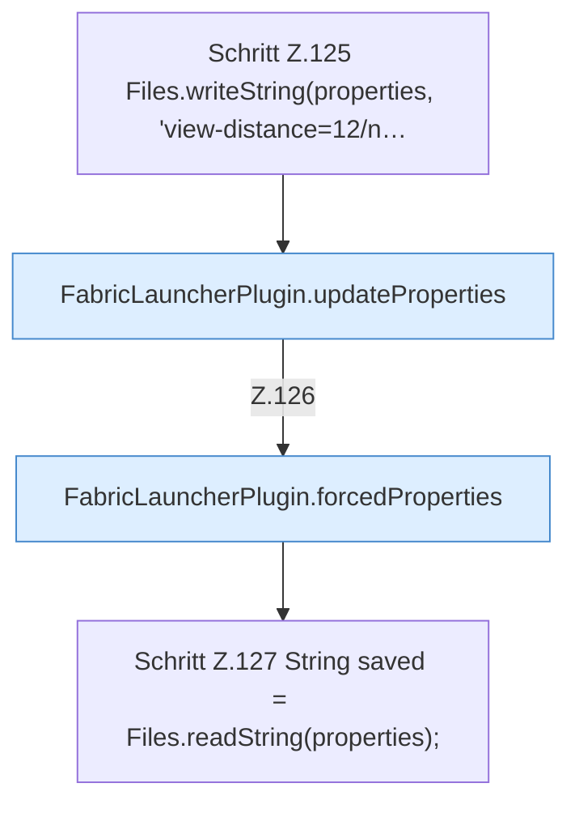

[[00 Start]] › [[Tests]] › [[HosterTest]] › [[HosterTest.Teil1]] › [[HosterTest.defaultsKeepVanillaGameplayAndNeverPauseWhenEmpty]] › [[HosterTest.defaultsKeepVanillaGameplayAndNeverPauseWhenEmpty.Teil2]]

# HosterTest.defaultsKeepVanillaGameplayAndNeverPauseWhenEmpty.Teil2

- Fortsetzung von `HosterTest.defaultsKeepVanillaGameplayAndNeverPauseWhenEmpty`, Quellreihenfolge.
