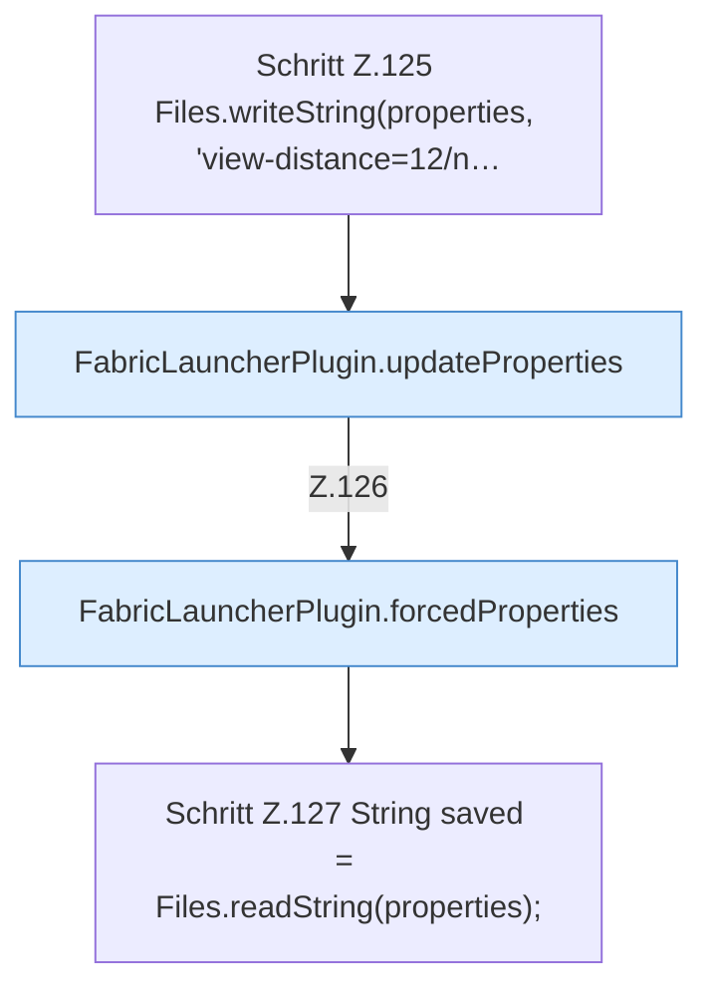

[[00 Start]] › [[Tests]] › [[HosterTest]] › [[HosterTest.Teil1]] › [[HosterTest.defaultsKeepVanillaGameplayAndNeverPauseWhenEmpty]] › [[HosterTest.defaultsKeepVanillaGameplayAndNeverPauseWhenEmpty.Teil2]]

# HosterTest.defaultsKeepVanillaGameplayAndNeverPauseWhenEmpty.Teil2



```knoten
Schritt Z.125 Files.writeString(properties, 'view-distance=12/n…
  Zeile 125: schreibt Text in eine Datei. `Files.writeString(properties, 'view-distance=12/n…`
FabricLauncherPlugin.updateProperties
  Aktualisiert `updateProperties`. Ruft `update`.
FabricLauncherPlugin.forcedProperties
  Erzwingt `forcedProperties`. Ruft `effectiveBindAddress`.
Schritt Z.127 String saved = Files.readString(properties);
  Zeile 127: liest Text aus einer Datei. `String saved = Files.readString(properties);`
```

- Fortsetzung von `HosterTest.defaultsKeepVanillaGameplayAndNeverPauseWhenEmpty`, Quellreihenfolge.
