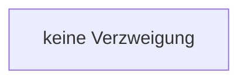

[[00 Start]] › [[Tests]] › [[HosterTest]] › [[HosterTest.Teil1]] › [[HosterTest.defaultsKeepVanillaGameplayAndNeverPauseWhenEmpty]] › [[HosterTest.defaultsKeepVanillaGameplayAndNeverPauseWhenEmpty.Teil3]]

# HosterTest.defaultsKeepVanillaGameplayAndNeverPauseWhenEmpty.Teil3



```knoten
keine Verzweigung
  Schritt. `keine Verzweigung`
```

> [!knoten]- Was die Blöcke tun
> - **keine Verzweigung**: Schritt. `keine Verzweigung`

- Ein weiterer Abschnitt derselben Übersicht.
- Fortsetzung von `HosterTest.defaultsKeepVanillaGameplayAndNeverPauseWhenEmpty`.
