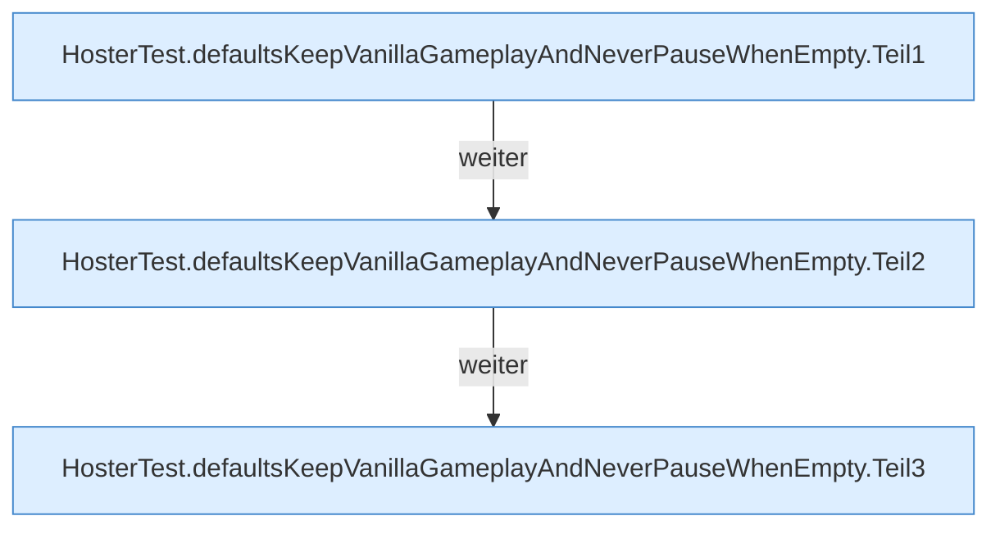

[[00 Start]] › [[Tests]] › [[HosterTest]] › [[HosterTest.Teil1]] › [[HosterTest.defaultsKeepVanillaGameplayAndNeverPauseWhenEmpty]]

# HosterTest.defaultsKeepVanillaGameplayAndNeverPauseWhenEmpty

`HosterTest.defaultsKeepVanillaGameplayAndNeverPauseWhenEmpty()` [src/test/java/de/aichele/childlauncher/HosterTest.java:105–132](https://github.com/Sciddie/minecraft-serverhoster-plugin/blob/95b02b953b0b4c23673e900e021a7c3c844aa37d/src/test/java/de/aichele/childlauncher/HosterTest.java#L105-L132)

- `defaultsKeepVanillaGameplayAndNeverPauseWhenEmpty` in `src/test/java/de/aichele/childlauncher/HosterTest.java`
- Auslöser: Test
