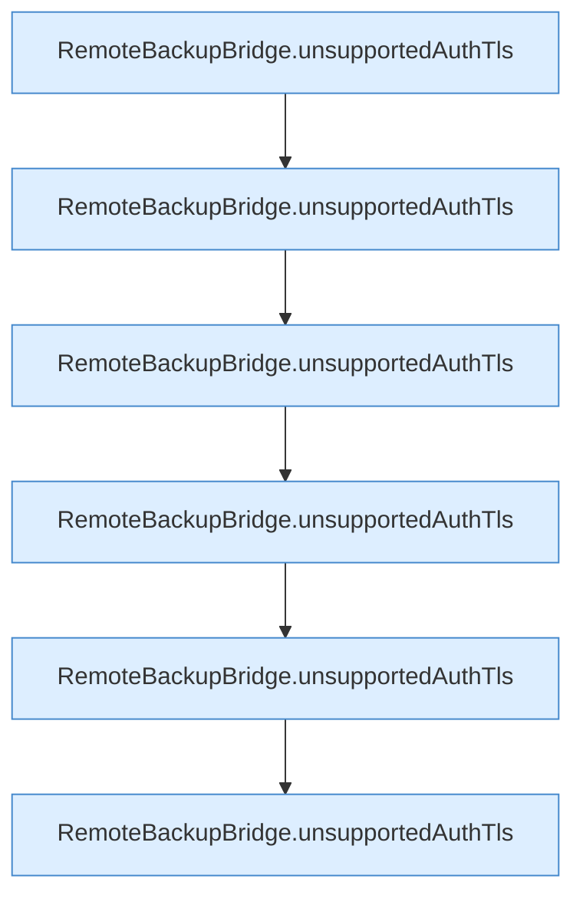

[[00 Start]] › [[Tests]] › [[HosterTest]] › [[HosterTest.Teil1]] › [[HosterTest.ftpAutoDetectionNeverDowngradesAfterTlsIsOffered]] › [[HosterTest.ftpAutoDetectionNeverDowngradesAfterTlsIsOffered.Teil1]]

# HosterTest.ftpAutoDetectionNeverDowngradesAfterTlsIsOffered.Teil1

- Fortsetzung von `HosterTest.ftpAutoDetectionNeverDowngradesAfterTlsIsOffered`, Quellreihenfolge.
