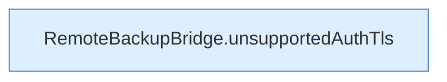

[[00 Start]] › [[Tests]] › [[HosterTest]] › [[HosterTest.Teil1]] › [[HosterTest.ftpAutoDetectionNeverDowngradesAfterTlsIsOffered]] › [[HosterTest.ftpAutoDetectionNeverDowngradesAfterTlsIsOffered.Teil2]]

# HosterTest.ftpAutoDetectionNeverDowngradesAfterTlsIsOffered.Teil2



```knoten
RemoteBackupBridge.unsupportedAuthTls
  Die Sicherung über das Netz macht hier einen einzelnen Schritt. Eine Ebene tiefer steht er genauer. `unsupportedAuthTls` in `RemoteBackupBridge.java`.
```

> [!knoten]- Was die Blöcke tun
> - **RemoteBackupBridge.unsupportedAuthTls**: Die Sicherung über das Netz macht hier einen einzelnen Schritt. Eine Ebene tiefer steht er genauer. `unsupportedAuthTls` in `RemoteBackupBridge.java`.

- Ein weiterer Abschnitt derselben Übersicht.
- Fortsetzung von `HosterTest.ftpAutoDetectionNeverDowngradesAfterTlsIsOffered`.
