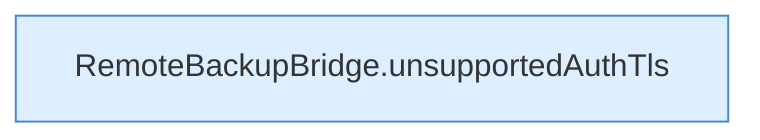

[[00 Start]] › [[Tests]] › [[HosterTest]] › [[HosterTest.Teil1]] › [[HosterTest.ftpAutoDetectionNeverDowngradesAfterTlsIsOffered]] › [[HosterTest.ftpAutoDetectionNeverDowngradesAfterTlsIsOffered.Teil2]]

# HosterTest.ftpAutoDetectionNeverDowngradesAfterTlsIsOffered.Teil2



```knoten
RemoteBackupBridge.unsupportedAuthTls
  `unsupportedAuthTls` in `RemoteBackupBridge.java`.
```

- Fortsetzung von `HosterTest.ftpAutoDetectionNeverDowngradesAfterTlsIsOffered`, Quellreihenfolge.
