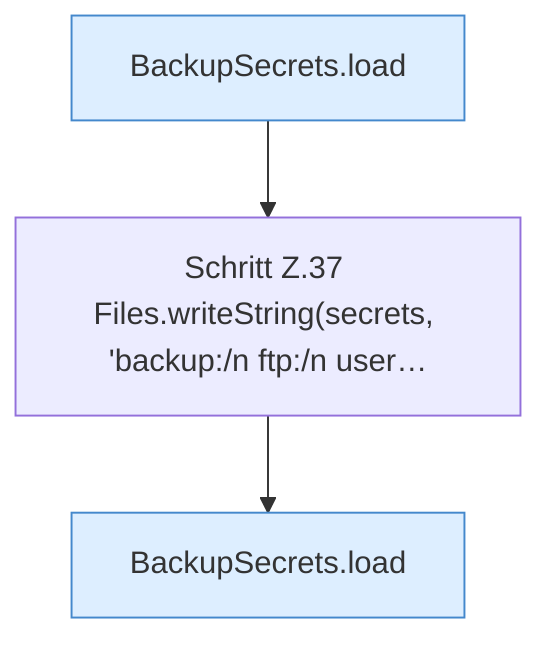

[[00 Start]] › [[Tests]] › [[HosterTest]] › [[HosterTest.Teil1]] › [[HosterTest.ftpCredentialsAreKeptInLocalSecretsFile]] › [[HosterTest.ftpCredentialsAreKeptInLocalSecretsFile.Teil1]]

# HosterTest.ftpCredentialsAreKeptInLocalSecretsFile.Teil1



```knoten
BackupSecrets.load
  Lädt `load`. Ruft `restrict`.
Schritt Z.37 Files.writeString(secrets, 'backup:/n ftp:/n user…
  Zeile 37: schreibt Text in eine Datei. `Files.writeString(secrets, 'backup:/n ftp:/n user…`
```

- Fortsetzung von `HosterTest.ftpCredentialsAreKeptInLocalSecretsFile`, Quellreihenfolge.
