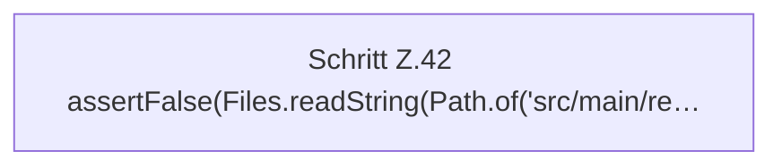

[[00 Start]] › [[Tests]] › [[HosterTest]] › [[HosterTest.Teil1]] › [[HosterTest.ftpCredentialsAreKeptInLocalSecretsFile]] › [[HosterTest.ftpCredentialsAreKeptInLocalSecretsFile.Teil2]]

# HosterTest.ftpCredentialsAreKeptInLocalSecretsFile.Teil2

- Fortsetzung von `HosterTest.ftpCredentialsAreKeptInLocalSecretsFile`, Quellreihenfolge.
