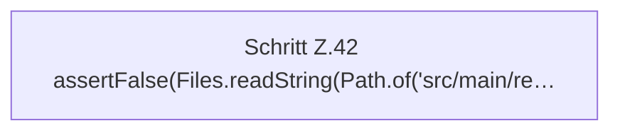

[[00 Start]] › [[Tests]] › [[HosterTest]] › [[HosterTest.Teil1]] › [[HosterTest.ftpCredentialsAreKeptInLocalSecretsFile]] › [[HosterTest.ftpCredentialsAreKeptInLocalSecretsFile.Teil2]]

# HosterTest.ftpCredentialsAreKeptInLocalSecretsFile.Teil2



```knoten
Schritt Z.42 assertFalse(Files.readString(Path.of('src/main/re…
  Zeile 42: liest Text aus einer Datei. `assertFalse(Files.readString(Path.of('src/main/re…`
```

> [!knoten]- Was die Blöcke tun
> - **Schritt Z.42 assertFalse(Files.readString(Path.of('src/main/re…**: Zeile 42: liest Text aus einer Datei. `assertFalse(Files.readString(Path.of('src/main/re…`

- Ein weiterer Abschnitt derselben Übersicht.
- Fortsetzung von `HosterTest.ftpCredentialsAreKeptInLocalSecretsFile`.
