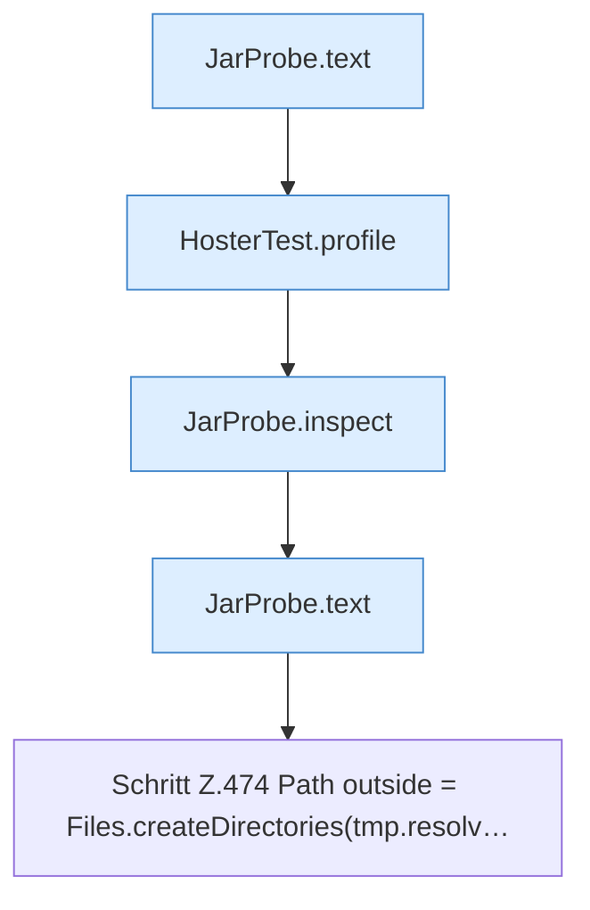

[[00 Start]] › [[Tests]] › [[HosterTest]] › [[HosterTest.Teil3]] › [[HosterTest.jarProbeStatsRegularFileAndSkipsSymlink]] › [[HosterTest.jarProbeStatsRegularFileAndSkipsSymlink.Teil2]]

# HosterTest.jarProbeStatsRegularFileAndSkipsSymlink.Teil2

- Fortsetzung von `HosterTest.jarProbeStatsRegularFileAndSkipsSymlink`, Quellreihenfolge.
