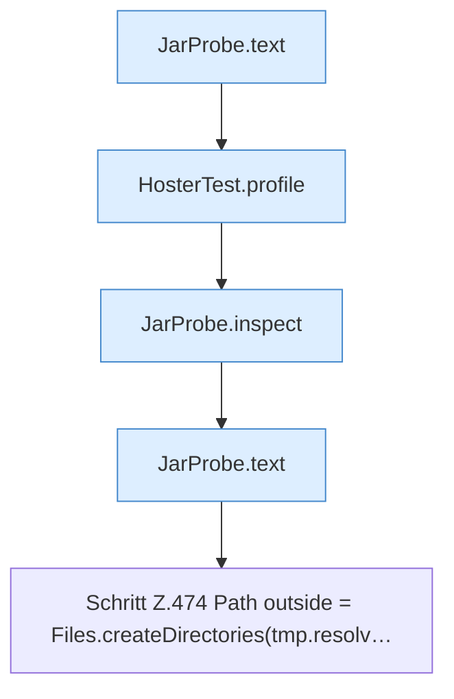

[[00 Start]] › [[Tests]] › [[HosterTest]] › [[HosterTest.Teil3]] › [[HosterTest.jarProbeStatsRegularFileAndSkipsSymlink]] › [[HosterTest.jarProbeStatsRegularFileAndSkipsSymlink.Teil2]]

# HosterTest.jarProbeStatsRegularFileAndSkipsSymlink.Teil2



```knoten
JarProbe.text
  Dieser Teil macht hier einen einzelnen Schritt. Eine Ebene tiefer steht er genauer. Antwortet mit Text `text`.
HosterTest.profile
  Ein Schritt in einem [[Glossar#Probelauf|Probelauf]]. Er gehört nicht zum laufenden Server. `profile` in `HosterTest.java`. Ruft `ServerProfile`. Nur Test.
JarProbe.inspect
  Dieser Teil macht hier einen einzelnen Schritt. Eine Ebene tiefer steht er genauer. `inspect` in `JarProbe.java`. Ruft `jarPath`, `jarName`.
Schritt Z.474 Path outside = Files.createDirectories(tmp.resolv…
  Zeile 474: Dateioperation. `Path outside = Files.createDirectories(tmp.resolv…`
```

> [!knoten]- Was die Blöcke tun
> - **JarProbe.text**: Dieser Teil macht hier einen einzelnen Schritt. Eine Ebene tiefer steht er genauer. Antwortet mit Text `text`.
> - **HosterTest.profile**: Ein Schritt in einem [[Glossar#Probelauf|Probelauf]]. Er gehört nicht zum laufenden Server. `profile` in `HosterTest.java`. Ruft `ServerProfile`. Nur Test.
> - **JarProbe.inspect**: Dieser Teil macht hier einen einzelnen Schritt. Eine Ebene tiefer steht er genauer. `inspect` in `JarProbe.java`. Ruft `jarPath`, `jarName`.
> - **Schritt Z.474 Path outside = Files.createDirectories(tmp.resolv…**: Zeile 474: Dateioperation. `Path outside = Files.createDirectories(tmp.resolv…`

- Ein weiterer Abschnitt derselben Übersicht.
- Fortsetzung von `HosterTest.jarProbeStatsRegularFileAndSkipsSymlink`.
