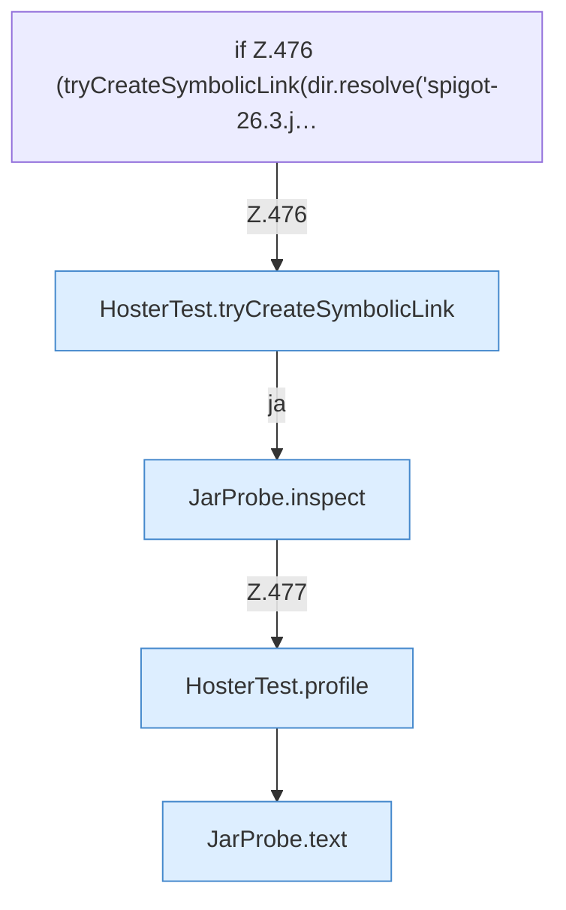

[[00 Start]] › [[Tests]] › [[HosterTest]] › [[HosterTest.Teil3]] › [[HosterTest.jarProbeStatsRegularFileAndSkipsSymlink]] › [[HosterTest.jarProbeStatsRegularFileAndSkipsSymlink.Teil3.Z476]]

# HosterTest.jarProbeStatsRegularFileAndSkipsSymlink.Teil3.Z476



```knoten
if Z.476 (tryCreateSymbolicLink(dir.resolve('spigot-26.3.j…
  Zeile 476: prüft `(tryCreateSymbolicLink(dir.resolve('spigot-26.3.j…`.
HosterTest.tryCreateSymbolicLink
  `tryCreateSymbolicLink` in `HosterTest.java`. Nur Test.
JarProbe.inspect
  `inspect` in `JarProbe.java`. Ruft `jarPath`, `jarName`.
HosterTest.profile
  `profile` in `HosterTest.java`. Ruft `ServerProfile`. Nur Test.
JarProbe.text
  Antwortet mit Text `text`.
```

- Fortsetzung von `HosterTest.jarProbeStatsRegularFileAndSkipsSymlink.Teil3`, Quellreihenfolge.
