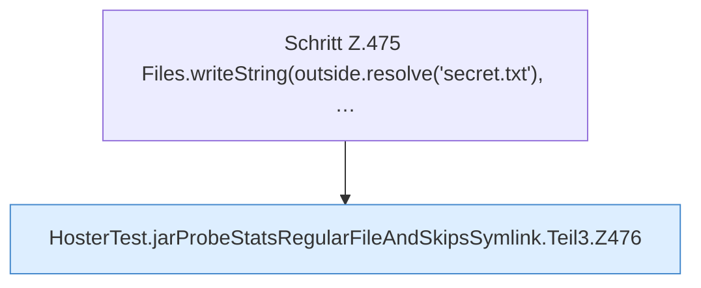

[[00 Start]] › [[Tests]] › [[HosterTest]] › [[HosterTest.Teil3]] › [[HosterTest.jarProbeStatsRegularFileAndSkipsSymlink]] › [[HosterTest.jarProbeStatsRegularFileAndSkipsSymlink.Teil3]]

# HosterTest.jarProbeStatsRegularFileAndSkipsSymlink.Teil3



```knoten
Schritt Z.475 Files.writeString(outside.resolve('secret.txt'), …
  Zeile 475: schreibt Text in eine Datei. `Files.writeString(outside.resolve('secret.txt'), …`
HosterTest.jarProbeStatsRegularFileAndSkipsSymlink.Teil3.Z476
  Fortsetzung des Ablaufs ab Zeile 476.
```

- Fortsetzung von `HosterTest.jarProbeStatsRegularFileAndSkipsSymlink`, Quellreihenfolge.
