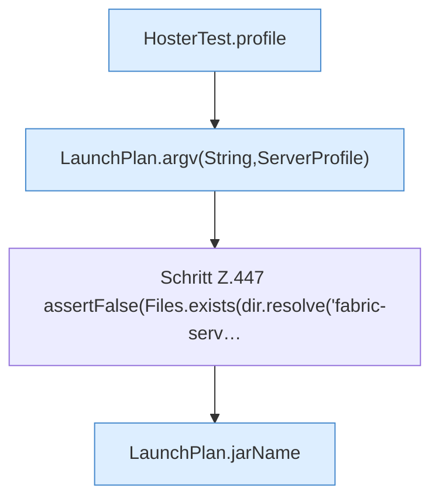

[[00 Start]] › [[Tests]] › [[HosterTest]] › [[HosterTest.Teil3]] › [[HosterTest.launchPlanDropsDeadFlagAndNamesJars]] › [[HosterTest.launchPlanDropsDeadFlagAndNamesJars.Teil1]]

# HosterTest.launchPlanDropsDeadFlagAndNamesJars.Teil1



```knoten
HosterTest.profile
  `profile` in `HosterTest.java`. Ruft `ServerProfile`. Nur Test.
LaunchPlan.argv(String,ServerProfile)
  `argv` in `LaunchPlan.java`. Ruft `argv`, `jarPath`.
Schritt Z.447 assertFalse(Files.exists(dir.resolve('fabric-serv…
  Zeile 447: Dateioperation. `assertFalse(Files.exists(dir.resolve('fabric-serv…`
LaunchPlan.jarName
  Betrifft das Jar `jarName`. Ruft `fileName`.
```

- Fortsetzung von `HosterTest.launchPlanDropsDeadFlagAndNamesJars`, Quellreihenfolge.
