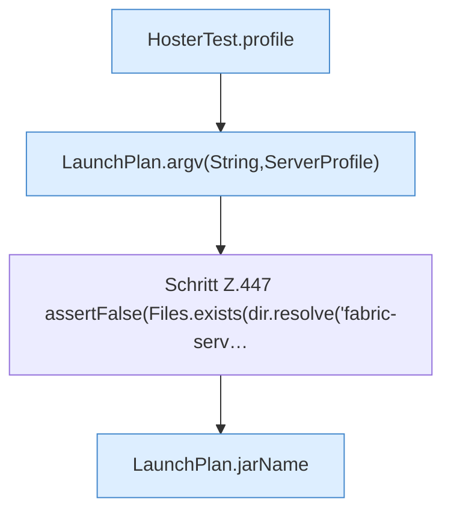

[[00 Start]] › [[Tests]] › [[HosterTest]] › [[HosterTest.Teil3]] › [[HosterTest.launchPlanDropsDeadFlagAndNamesJars]] › [[HosterTest.launchPlanDropsDeadFlagAndNamesJars.Teil1]]

# HosterTest.launchPlanDropsDeadFlagAndNamesJars.Teil1



```knoten
HosterTest.profile
  Ein Schritt in einem [[Glossar#Probelauf|Probelauf]]. Er gehört nicht zum laufenden Server. `profile` in `HosterTest.java`. Ruft `ServerProfile`. Nur Test.
LaunchPlan.argv(String,ServerProfile)
  Dieser Teil macht hier einen einzelnen Schritt. Eine Ebene tiefer steht er genauer. `argv` in `LaunchPlan.java`. Ruft `argv`, `jarPath`.
Schritt Z.447 assertFalse(Files.exists(dir.resolve('fabric-serv…
  Zeile 447: Dateioperation. `assertFalse(Files.exists(dir.resolve('fabric-serv…`
LaunchPlan.jarName
  Dieser Teil kümmert sich um den Namen. Betrifft das Jar `jarName`. Ruft `fileName`.
```

> [!knoten]- Was die Blöcke tun
> - **HosterTest.profile**: Ein Schritt in einem [[Glossar#Probelauf|Probelauf]]. Er gehört nicht zum laufenden Server. `profile` in `HosterTest.java`. Ruft `ServerProfile`. Nur Test.
> - **LaunchPlan.argv(String,ServerProfile)**: Dieser Teil macht hier einen einzelnen Schritt. Eine Ebene tiefer steht er genauer. `argv` in `LaunchPlan.java`. Ruft `argv`, `jarPath`.
> - **Schritt Z.447 assertFalse(Files.exists(dir.resolve('fabric-serv…**: Zeile 447: Dateioperation. `assertFalse(Files.exists(dir.resolve('fabric-serv…`
> - **LaunchPlan.jarName**: Dieser Teil kümmert sich um den Namen. Betrifft das Jar `jarName`. Ruft `fileName`.

- Ein weiterer Abschnitt derselben Übersicht.
- Fortsetzung von `HosterTest.launchPlanDropsDeadFlagAndNamesJars`.
