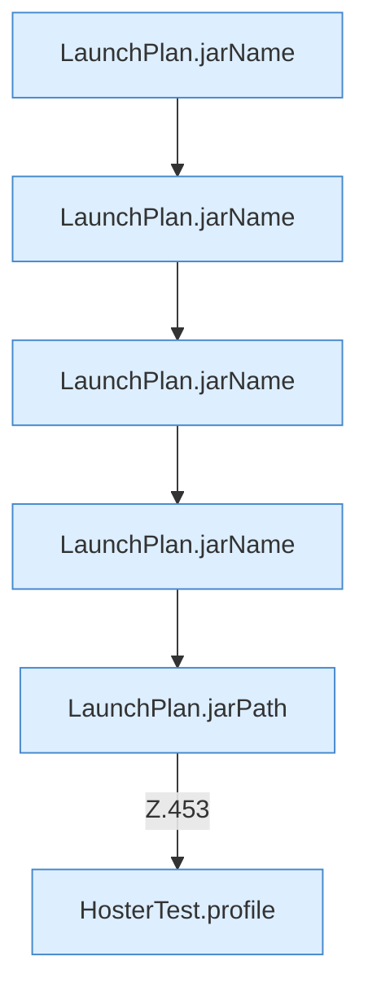

[[00 Start]] › [[Tests]] › [[HosterTest]] › [[HosterTest.Teil3]] › [[HosterTest.launchPlanDropsDeadFlagAndNamesJars]] › [[HosterTest.launchPlanDropsDeadFlagAndNamesJars.Teil2]]

# HosterTest.launchPlanDropsDeadFlagAndNamesJars.Teil2



```knoten
LaunchPlan.jarName
  Dieser Teil kümmert sich um den Namen. Betrifft das Jar `jarName`. Ruft `fileName`.
LaunchPlan.jarPath
  Dieser Teil kümmert sich um den Pfad. Betrifft das Jar `jarPath`. Ruft `directory`, `jarName`.
HosterTest.profile
  Ein Schritt in einem [[Glossar#Probelauf|Probelauf]]. Er gehört nicht zum laufenden Server. `profile` in `HosterTest.java`. Ruft `ServerProfile`. Nur Test.
```

> [!knoten]- Was die Blöcke tun
> - **LaunchPlan.jarName**: Dieser Teil kümmert sich um den Namen. Betrifft das Jar `jarName`. Ruft `fileName`.
> - **LaunchPlan.jarPath**: Dieser Teil kümmert sich um den Pfad. Betrifft das Jar `jarPath`. Ruft `directory`, `jarName`.
> - **HosterTest.profile**: Ein Schritt in einem [[Glossar#Probelauf|Probelauf]]. Er gehört nicht zum laufenden Server. `profile` in `HosterTest.java`. Ruft `ServerProfile`. Nur Test.

- Ein weiterer Abschnitt derselben Übersicht.
- Fortsetzung von `HosterTest.launchPlanDropsDeadFlagAndNamesJars`.
