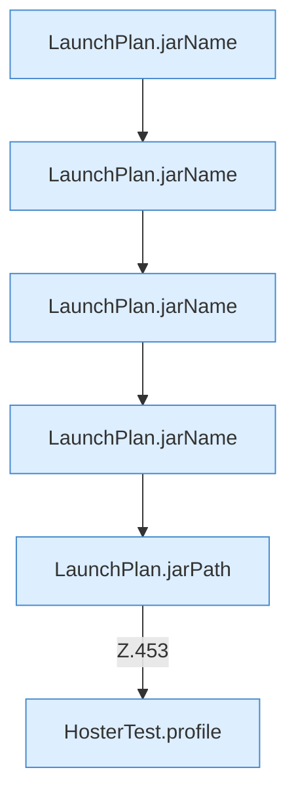

[[00 Start]] › [[Tests]] › [[HosterTest]] › [[HosterTest.Teil3]] › [[HosterTest.launchPlanDropsDeadFlagAndNamesJars]] › [[HosterTest.launchPlanDropsDeadFlagAndNamesJars.Teil2]]

# HosterTest.launchPlanDropsDeadFlagAndNamesJars.Teil2

- Fortsetzung von `HosterTest.launchPlanDropsDeadFlagAndNamesJars`, Quellreihenfolge.
