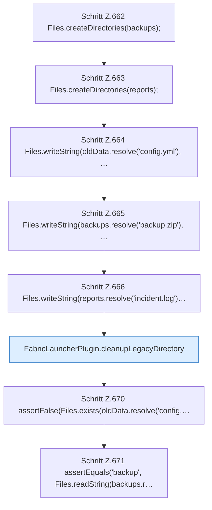

[[00 Start]] › [[Tests]] › [[HosterTest]] › [[HosterTest.Teil5]] › [[HosterTest.legacyCleanupRetainsBackupsAndMemoryReports]] › [[HosterTest.legacyCleanupRetainsBackupsAndMemoryReports.Teil1]]

# HosterTest.legacyCleanupRetainsBackupsAndMemoryReports.Teil1



```knoten
Schritt Z.662 Files.createDirectories(backups);
  Zeile 662: Dateioperation. `Files.createDirectories(backups);`
Schritt Z.663 Files.createDirectories(reports);
  Zeile 663: Dateioperation. `Files.createDirectories(reports);`
Schritt Z.664 Files.writeString(oldData.resolve('config.yml'), …
  Zeile 664: schreibt Text in eine Datei. `Files.writeString(oldData.resolve('config.yml'), …`
Schritt Z.665 Files.writeString(backups.resolve('backup.zip'), …
  Zeile 665: schreibt Text in eine Datei. `Files.writeString(backups.resolve('backup.zip'), …`
Schritt Z.666 Files.writeString(reports.resolve('incident.log')…
  Zeile 666: schreibt Text in eine Datei. `Files.writeString(reports.resolve('incident.log')…`
FabricLauncherPlugin.cleanupLegacyDirectory
  Das [[Glossar#Plugin|Plugin]] räumt auf den alten Weg. Räumt auf `cleanupLegacyDirectory`. Ruft `preVisitDirectory`, `visitFile`, `postVisitDirectory`.
Schritt Z.670 assertFalse(Files.exists(oldData.resolve('config.…
  Zeile 670: Dateioperation. `assertFalse(Files.exists(oldData.resolve('config.…`
Schritt Z.671 assertEquals('backup', Files.readString(backups.r…
  Zeile 671: liest Text aus einer Datei. `assertEquals('backup', Files.readString(backups.r…`
```

> [!knoten]- Was die Blöcke tun
> - **Schritt Z.662 Files.createDirectories(backups);**: Zeile 662: Dateioperation. `Files.createDirectories(backups);`
> - **Schritt Z.663 Files.createDirectories(reports);**: Zeile 663: Dateioperation. `Files.createDirectories(reports);`
> - **Schritt Z.664 Files.writeString(oldData.resolve('config.yml'), …**: Zeile 664: schreibt Text in eine Datei. `Files.writeString(oldData.resolve('config.yml'), …`
> - **Schritt Z.665 Files.writeString(backups.resolve('backup.zip'), …**: Zeile 665: schreibt Text in eine Datei. `Files.writeString(backups.resolve('backup.zip'), …`
> - **Schritt Z.666 Files.writeString(reports.resolve('incident.log')…**: Zeile 666: schreibt Text in eine Datei. `Files.writeString(reports.resolve('incident.log')…`
> - **FabricLauncherPlugin.cleanupLegacyDirectory**: Das [[Glossar#Plugin|Plugin]] räumt auf den alten Weg. Räumt auf `cleanupLegacyDirectory`. Ruft `preVisitDirectory`, `visitFile`, `postVisitDirectory`.
> - **Schritt Z.670 assertFalse(Files.exists(oldData.resolve('config.…**: Zeile 670: Dateioperation. `assertFalse(Files.exists(oldData.resolve('config.…`
> - **Schritt Z.671 assertEquals('backup', Files.readString(backups.r…**: Zeile 671: liest Text aus einer Datei. `assertEquals('backup', Files.readString(backups.r…`

- Ein weiterer Abschnitt derselben Übersicht.
- Fortsetzung von `HosterTest.legacyCleanupRetainsBackupsAndMemoryReports`.
