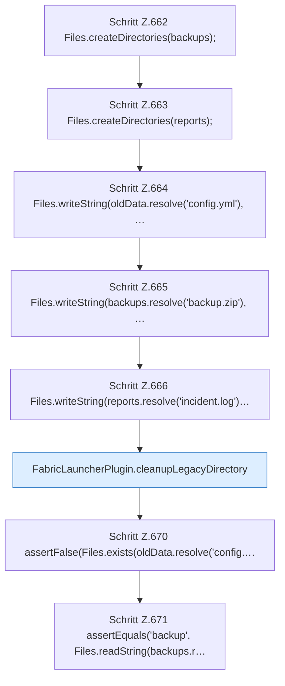

[[00 Start]] › [[Tests]] › [[HosterTest]] › [[HosterTest.Teil5]] › [[HosterTest.legacyCleanupRetainsBackupsAndMemoryReports]] › [[HosterTest.legacyCleanupRetainsBackupsAndMemoryReports.Teil1]]

# HosterTest.legacyCleanupRetainsBackupsAndMemoryReports.Teil1

- Fortsetzung von `HosterTest.legacyCleanupRetainsBackupsAndMemoryReports`, Quellreihenfolge.
