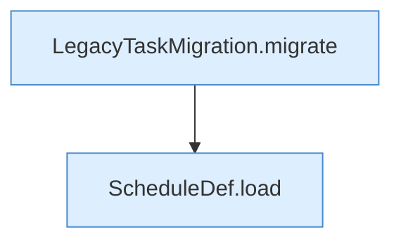

[[00 Start]] › [[Tests]] › [[HosterTest]] › [[HosterTest.Teil3]] › [[HosterTest.legacySchedulesMigrateOnlySupportedTasksAndPreserveTheRest]] › [[HosterTest.legacySchedulesMigrateOnlySupportedTasksAndPreserveTheRest.Teil1]]

# HosterTest.legacySchedulesMigrateOnlySupportedTasksAndPreserveTheRest.Teil1



```knoten
LegacyTaskMigration.migrate
  Übernimmt den alten Wert von `migrate`. Ruft `load`, `convert`, `toConfig`.
ScheduleDef.load
  Lädt `load`. Ruft `asMap`, `Action`, `string`.
```

- Fortsetzung von `HosterTest.legacySchedulesMigrateOnlySupportedTasksAndPreserveTheRest`, Quellreihenfolge.
