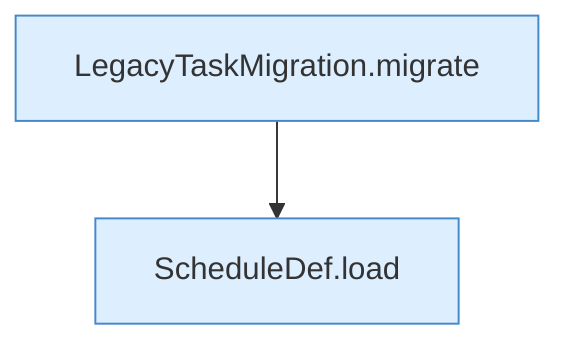

[[00 Start]] › [[Tests]] › [[HosterTest]] › [[HosterTest.Teil3]] › [[HosterTest.legacySchedulesMigrateOnlySupportedTasksAndPreserveTheRest]] › [[HosterTest.legacySchedulesMigrateOnlySupportedTasksAndPreserveTheRest.Teil1]]

# HosterTest.legacySchedulesMigrateOnlySupportedTasksAndPreserveTheRest.Teil1

- Fortsetzung von `HosterTest.legacySchedulesMigrateOnlySupportedTasksAndPreserveTheRest`, Quellreihenfolge.
