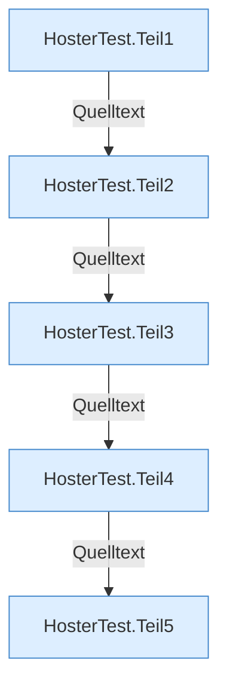

[[00 Start]] › [[Tests]] › [[HosterTest]]

# HosterTest



```knoten
HosterTest.Teil1
  Abschnitt 1 dieses Ablaufs, in Quellreihenfolge.
HosterTest.Teil2
  Abschnitt 2 dieses Ablaufs, in Quellreihenfolge.
HosterTest.Teil3
  Abschnitt 3 dieses Ablaufs, in Quellreihenfolge.
HosterTest.Teil4
  Abschnitt 4 dieses Ablaufs, in Quellreihenfolge.
HosterTest.Teil5
  Abschnitt 5 dieses Ablaufs, in Quellreihenfolge.
```


