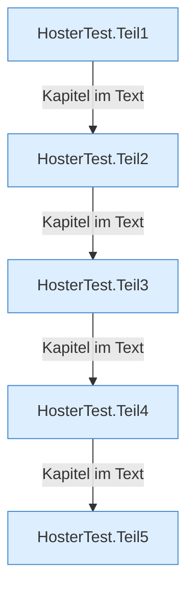

[[00 Start]] › [[Tests]] › [[HosterTest]]

# HosterTest



```knoten
HosterTest.Teil1
  Ein weiterer Abschnitt derselben Übersicht.
HosterTest.Teil2
  Ein weiterer Abschnitt derselben Übersicht.
HosterTest.Teil3
  Ein weiterer Abschnitt derselben Übersicht.
HosterTest.Teil4
  Ein weiterer Abschnitt derselben Übersicht.
HosterTest.Teil5
  Ein weiterer Abschnitt derselben Übersicht.
```

> [!knoten] Was die Blöcke tun
> - **HosterTest.Teil1**: Ein weiterer Abschnitt derselben Übersicht.
> - **HosterTest.Teil2**: Ein weiterer Abschnitt derselben Übersicht.
> - **HosterTest.Teil3**: Ein weiterer Abschnitt derselben Übersicht.
> - **HosterTest.Teil4**: Ein weiterer Abschnitt derselben Übersicht.
> - **HosterTest.Teil5**: Ein weiterer Abschnitt derselben Übersicht.

- Der große [[Glossar#Probelauf|Probelauf]] für das [[Glossar#Plugin|Plugin]].
