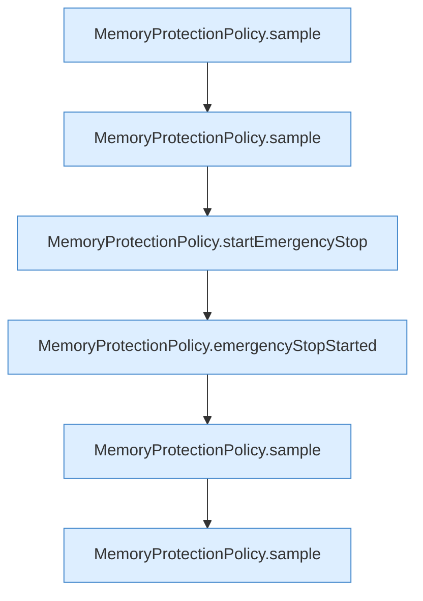

[[00 Start]] › [[Tests]] › [[HosterTest]] › [[HosterTest.Teil4]] › [[HosterTest.memoryProtectionWaitsForSustainedPressureAndStableRecovery]] › [[HosterTest.memoryProtectionWaitsForSustainedPressureAndStableRecovery.Teil2]]

# HosterTest.memoryProtectionWaitsForSustainedPressureAndStableRecovery.Teil2



```knoten
MemoryProtectionPolicy.sample
  Misst `sample`.
MemoryProtectionPolicy.startEmergencyStop
  Startet `startEmergencyStop`.
MemoryProtectionPolicy.emergencyStopStarted
  `emergencyStopStarted` in `MemoryProtectionPolicy.java`.
```

- Fortsetzung von `HosterTest.memoryProtectionWaitsForSustainedPressureAndStableRecovery`, Quellreihenfolge.
