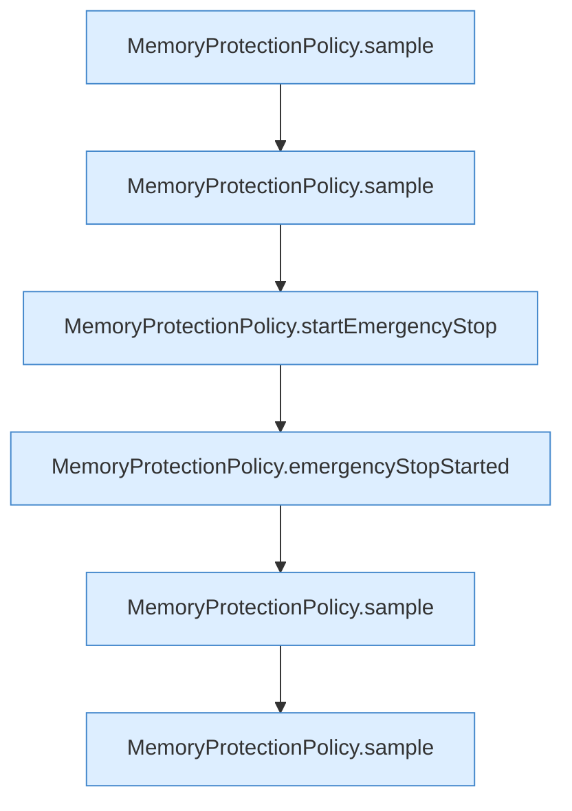

[[00 Start]] › [[Tests]] › [[HosterTest]] › [[HosterTest.Teil4]] › [[HosterTest.memoryProtectionWaitsForSustainedPressureAndStableRecovery]] › [[HosterTest.memoryProtectionWaitsForSustainedPressureAndStableRecovery.Teil2]]

# HosterTest.memoryProtectionWaitsForSustainedPressureAndStableRecovery.Teil2



```knoten
MemoryProtectionPolicy.sample
  Dieser Teil misst das. Misst `sample`.
MemoryProtectionPolicy.startEmergencyStop
  Dieser Teil startet den [[Glossar#Notstopp|Notstopp]] den [[Glossar#Stopp|Stopp]]. Startet `startEmergencyStop`.
MemoryProtectionPolicy.emergencyStopStarted
  Dieser Teil stoppt hier einen Schritt. Eine Ebene tiefer steht er genauer. `emergencyStopStarted` in `MemoryProtectionPolicy.java`.
```

> [!knoten]- Was die Blöcke tun
> - **MemoryProtectionPolicy.sample**: Dieser Teil misst das. Misst `sample`.
> - **MemoryProtectionPolicy.startEmergencyStop**: Dieser Teil startet den [[Glossar#Notstopp|Notstopp]] den [[Glossar#Stopp|Stopp]]. Startet `startEmergencyStop`.
> - **MemoryProtectionPolicy.emergencyStopStarted**: Dieser Teil stoppt hier einen Schritt. Eine Ebene tiefer steht er genauer. `emergencyStopStarted` in `MemoryProtectionPolicy.java`.

- Ein weiterer Abschnitt derselben Übersicht.
- Fortsetzung von `HosterTest.memoryProtectionWaitsForSustainedPressureAndStableRecovery`.
