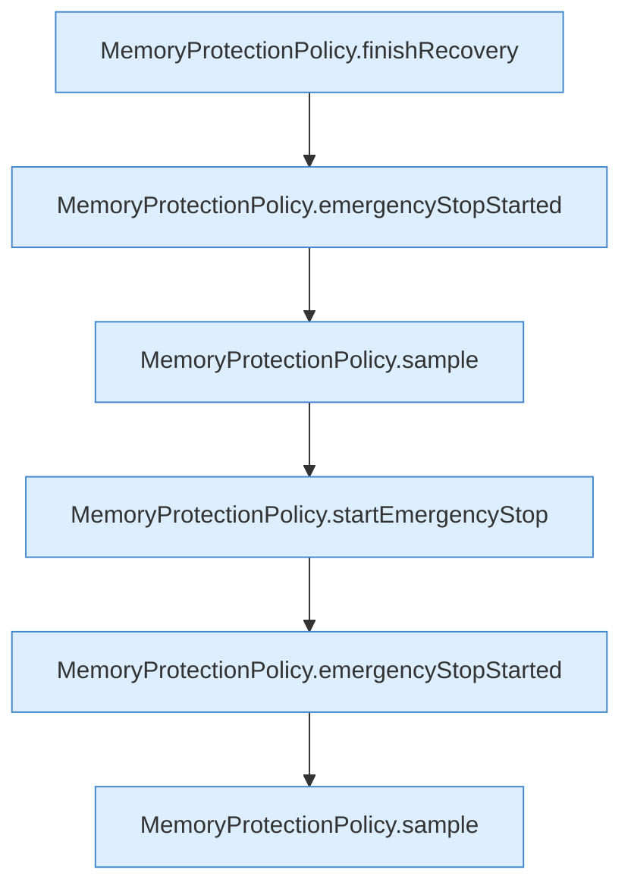

[[00 Start]] › [[Tests]] › [[HosterTest]] › [[HosterTest.Teil4]] › [[HosterTest.memoryProtectionWaitsForSustainedPressureAndStableRecovery]] › [[HosterTest.memoryProtectionWaitsForSustainedPressureAndStableRecovery.Teil3]]

# HosterTest.memoryProtectionWaitsForSustainedPressureAndStableRecovery.Teil3

- Fortsetzung von `HosterTest.memoryProtectionWaitsForSustainedPressureAndStableRecovery`, Quellreihenfolge.
