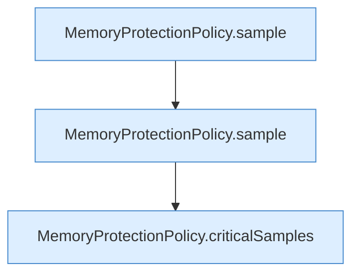

[[00 Start]] › [[Tests]] › [[HosterTest]] › [[HosterTest.Teil4]] › [[HosterTest.memoryProtectionWaitsForSustainedPressureAndStableRecovery]] › [[HosterTest.memoryProtectionWaitsForSustainedPressureAndStableRecovery.Teil4]]

# HosterTest.memoryProtectionWaitsForSustainedPressureAndStableRecovery.Teil4



```knoten
MemoryProtectionPolicy.sample
  Misst `sample`.
MemoryProtectionPolicy.criticalSamples
  `criticalSamples` in `MemoryProtectionPolicy.java`.
```

- Fortsetzung von `HosterTest.memoryProtectionWaitsForSustainedPressureAndStableRecovery`, Quellreihenfolge.
