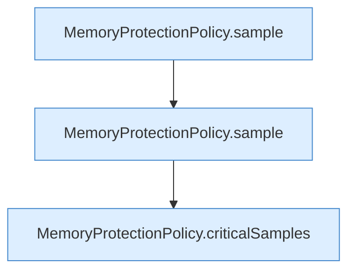

[[00 Start]] › [[Tests]] › [[HosterTest]] › [[HosterTest.Teil4]] › [[HosterTest.memoryProtectionWaitsForSustainedPressureAndStableRecovery]] › [[HosterTest.memoryProtectionWaitsForSustainedPressureAndStableRecovery.Teil4]]

# HosterTest.memoryProtectionWaitsForSustainedPressureAndStableRecovery.Teil4



```knoten
MemoryProtectionPolicy.sample
  Dieser Teil misst das. Misst `sample`.
MemoryProtectionPolicy.criticalSamples
  Dieser Teil macht hier einen einzelnen Schritt. Eine Ebene tiefer steht er genauer. `criticalSamples` in `MemoryProtectionPolicy.java`.
```

> [!knoten]- Was die Blöcke tun
> - **MemoryProtectionPolicy.sample**: Dieser Teil misst das. Misst `sample`.
> - **MemoryProtectionPolicy.criticalSamples**: Dieser Teil macht hier einen einzelnen Schritt. Eine Ebene tiefer steht er genauer. `criticalSamples` in `MemoryProtectionPolicy.java`.

- Ein weiterer Abschnitt derselben Übersicht.
- Fortsetzung von `HosterTest.memoryProtectionWaitsForSustainedPressureAndStableRecovery`.
