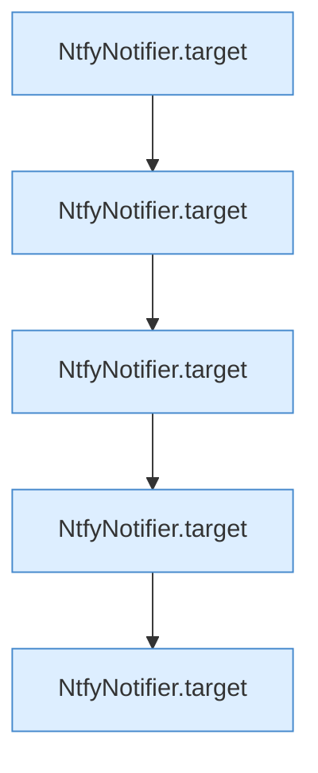

[[00 Start]] › [[Tests]] › [[HosterTest]] › [[HosterTest.Teil1]] › [[HosterTest.ntfyRequiresHttpsAndConstructsTopicEndpoint]]

# HosterTest.ntfyRequiresHttpsAndConstructsTopicEndpoint

`HosterTest.ntfyRequiresHttpsAndConstructsTopicEndpoint()` [src/test/java/de/aichele/childlauncher/HosterTest.java:45–53](https://github.com/Sciddie/minecraft-serverhoster-plugin/blob/95b02b953b0b4c23673e900e021a7c3c844aa37d/src/test/java/de/aichele/childlauncher/HosterTest.java#L45-L53)



```knoten
NtfyNotifier.target
  Dieser Teil macht hier einen einzelnen Schritt. Eine Ebene tiefer steht er genauer. `target` in `NtfyNotifier.java`.
```

> [!knoten]- Was die Blöcke tun
> - **NtfyNotifier.target**: Dieser Teil macht hier einen einzelnen Schritt. Eine Ebene tiefer steht er genauer. `target` in `NtfyNotifier.java`.

- Ein Schritt in einem [[Glossar#Probelauf|Probelauf]]. Er gehört nicht zum laufenden Server.
- `ntfyRequiresHttpsAndConstructsTopicEndpoint` in `src/test/java/de/aichele/childlauncher/HosterTest.java`
- Das ist ein Probelauf, kein Teil des laufenden Servers.
