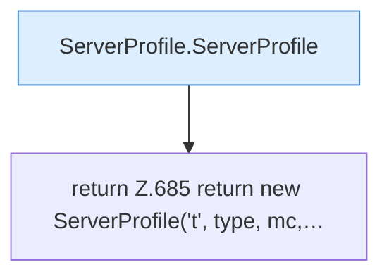

[[00 Start]] › [[Tests]] › [[HosterTest]] › [[HosterTest.Teil5]] › [[HosterTest.profile]]

# HosterTest.profile

`HosterTest.profile(String type, String mc, String custom, List<String> flags, List<String> args, String dir)` [src/test/java/de/aichele/childlauncher/HosterTest.java:684–686](https://github.com/Sciddie/minecraft-serverhoster-plugin/blob/95b02b953b0b4c23673e900e021a7c3c844aa37d/src/test/java/de/aichele/childlauncher/HosterTest.java#L684-L686)



```knoten
ServerProfile.ServerProfile
  Die Serverbeschreibung kümmert sich um die Beschreibung. `ServerProfile` in `ServerProfile.java`.
return Z.685 return new ServerProfile('t', type, mc,…
  Zeile 685: Rückgabe `return new ServerProfile('t', type, mc,…`.
```

> [!knoten]- Was die Blöcke tun
> - **ServerProfile.ServerProfile**: Die Serverbeschreibung kümmert sich um die Beschreibung. `ServerProfile` in `ServerProfile.java`.
> - **return Z.685 return new ServerProfile('t', type, mc,…**: Zeile 685: Rückgabe `return new ServerProfile('t', type, mc,…`.

- Ein Schritt in einem [[Glossar#Probelauf|Probelauf]]. Er gehört nicht zum laufenden Server.
- `profile` in `src/test/java/de/aichele/childlauncher/HosterTest.java`
- Das ist ein Probelauf, kein Teil des laufenden Servers.
