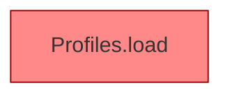

[[00 Start]] › [[Tests]] › [[HosterTest]] › [[HosterTest.Teil1]] › [[HosterTest.profilesKeepLegacyRootAndAddServers]] › [[HosterTest.profilesKeepLegacyRootAndAddServers.Teil2]]

# HosterTest.profilesKeepLegacyRootAndAddServers.Teil2



```knoten
Profiles.load
  Die Serverbeschreibung lädt das. Lädt `load`. Ruft `one`, `str`, `copyId`. [[Glossar#Befund|Befund]]: angemeldet aber nicht umgesetzt, sicher. ServerProfile.java Profiles.load liest servers.*, reloadProfiles nutzt nur den ersten
```

> [!knoten]- Was die Blöcke tun
> - **Profiles.load**: Die Serverbeschreibung lädt das. Lädt `load`. Ruft `one`, `str`, `copyId`. [[Glossar#Befund|Befund]]: angemeldet aber nicht umgesetzt, sicher. ServerProfile.java Profiles.load liest servers.*, reloadProfiles nutzt nur den ersten

- Ein weiterer Abschnitt derselben Übersicht.
- Fortsetzung von `HosterTest.profilesKeepLegacyRootAndAddServers`.
