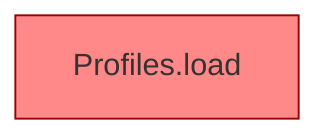

[[00 Start]] › [[Tests]] › [[HosterTest]] › [[HosterTest.Teil1]] › [[HosterTest.profilesKeepLegacyRootAndAddServers]] › [[HosterTest.profilesKeepLegacyRootAndAddServers.Teil2]]

# HosterTest.profilesKeepLegacyRootAndAddServers.Teil2



```knoten
Profiles.load
  Lädt `load`. Ruft `one`, `str`, `copyId`. Befund: angemeldet aber nicht umgesetzt (sicher).
```

- Fortsetzung von `HosterTest.profilesKeepLegacyRootAndAddServers`, Quellreihenfolge.
