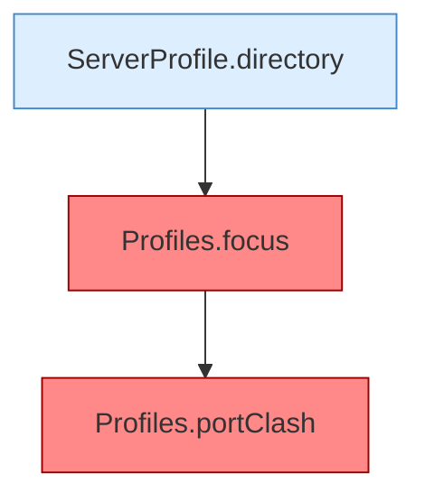

[[00 Start]] › [[Tests]] › [[HosterTest]] › [[HosterTest.Teil1]] › [[HosterTest.profilesKeepLegacyRootAndAddServers]] › [[HosterTest.profilesKeepLegacyRootAndAddServers.Teil3]]

# HosterTest.profilesKeepLegacyRootAndAddServers.Teil3



```knoten
ServerProfile.directory
  Die Serverbeschreibung macht hier einen einzelnen Schritt. Eine Ebene tiefer steht er genauer. `directory` in `ServerProfile.java`.
Profiles.focus
  Würde den gemeinten Server aus den [[Glossar#Einstellungen|Einstellungen]] lesen. Der laufende Weg benutzt das nicht. Wird vom [[Glossar#Plugin|Plugin]]-Kern nicht für die laufende Auswahl benutzt. [[Glossar#Befund|Befund]]: angemeldet aber nicht umgesetzt, wahrscheinlich. ServerProfile.java:85, nur Tests rufen Profiles.focus
Profiles.portClash
  Würde merken, wenn zwei Server dieselbe Türnummer hätten. Der laufende Weg benutzt das nicht. Wird vom [[Glossar#Plugin|Plugin]]-Kern nicht ausgewertet. [[Glossar#Befund|Befund]]: angemeldet aber nicht umgesetzt, wahrscheinlich. ServerProfile.java:79, nur Tests rufen Profiles.portClash
```

> [!knoten]- Was die Blöcke tun
> - **ServerProfile.directory**: Die Serverbeschreibung macht hier einen einzelnen Schritt. Eine Ebene tiefer steht er genauer. `directory` in `ServerProfile.java`.
> - **Profiles.focus**: Würde den gemeinten Server aus den [[Glossar#Einstellungen|Einstellungen]] lesen. Der laufende Weg benutzt das nicht. Wird vom [[Glossar#Plugin|Plugin]]-Kern nicht für die laufende Auswahl benutzt. [[Glossar#Befund|Befund]]: angemeldet aber nicht umgesetzt, wahrscheinlich. ServerProfile.java:85, nur Tests rufen Profiles.focus
> - **Profiles.portClash**: Würde merken, wenn zwei Server dieselbe Türnummer hätten. Der laufende Weg benutzt das nicht. Wird vom [[Glossar#Plugin|Plugin]]-Kern nicht ausgewertet. [[Glossar#Befund|Befund]]: angemeldet aber nicht umgesetzt, wahrscheinlich. ServerProfile.java:79, nur Tests rufen Profiles.portClash

- Ein weiterer Abschnitt derselben Übersicht.
- Fortsetzung von `HosterTest.profilesKeepLegacyRootAndAddServers`.
