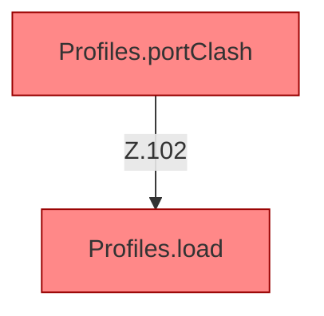

[[00 Start]] › [[Tests]] › [[HosterTest]] › [[HosterTest.Teil1]] › [[HosterTest.profilesKeepLegacyRootAndAddServers]] › [[HosterTest.profilesKeepLegacyRootAndAddServers.Teil4]]

# HosterTest.profilesKeepLegacyRootAndAddServers.Teil4



```knoten
Profiles.portClash
  Würde merken, wenn zwei Server dieselbe Türnummer hätten. Der laufende Weg benutzt das nicht. Wird vom [[Glossar#Plugin|Plugin]]-Kern nicht ausgewertet. [[Glossar#Befund|Befund]]: angemeldet aber nicht umgesetzt, wahrscheinlich. ServerProfile.java:79, nur Tests rufen Profiles.portClash
Profiles.load
  Die Serverbeschreibung lädt das. Lädt `load`. Ruft `one`, `str`, `copyId`. [[Glossar#Befund|Befund]]: angemeldet aber nicht umgesetzt, sicher. ServerProfile.java Profiles.load liest servers.*, reloadProfiles nutzt nur den ersten
```

> [!knoten]- Was die Blöcke tun
> - **Profiles.portClash**: Würde merken, wenn zwei Server dieselbe Türnummer hätten. Der laufende Weg benutzt das nicht. Wird vom [[Glossar#Plugin|Plugin]]-Kern nicht ausgewertet. [[Glossar#Befund|Befund]]: angemeldet aber nicht umgesetzt, wahrscheinlich. ServerProfile.java:79, nur Tests rufen Profiles.portClash
> - **Profiles.load**: Die Serverbeschreibung lädt das. Lädt `load`. Ruft `one`, `str`, `copyId`. [[Glossar#Befund|Befund]]: angemeldet aber nicht umgesetzt, sicher. ServerProfile.java Profiles.load liest servers.*, reloadProfiles nutzt nur den ersten

- Ein weiterer Abschnitt derselben Übersicht.
- Fortsetzung von `HosterTest.profilesKeepLegacyRootAndAddServers`.
