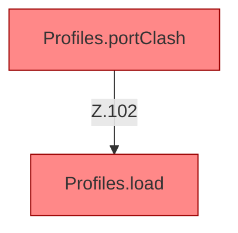

[[00 Start]] › [[Tests]] › [[HosterTest]] › [[HosterTest.Teil1]] › [[HosterTest.profilesKeepLegacyRootAndAddServers]] › [[HosterTest.profilesKeepLegacyRootAndAddServers.Teil4]]

# HosterTest.profilesKeepLegacyRootAndAddServers.Teil4

- Fortsetzung von `HosterTest.profilesKeepLegacyRootAndAddServers`, Quellreihenfolge.
